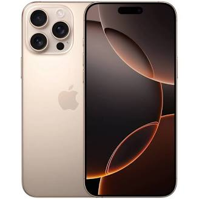
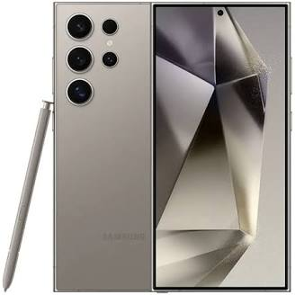

# [Vận dụng chuyên sâu] Thiết kế prompt so sánh tính năng iPhone và Samsung
**Bước 1**:
 Đầu vào (Input) 
Đối tượng so sánh: iPhone 16 Pro Max và Samsung Galaxy S24 Ultra
Tiêu chí: dung lương pin và hệ thống camera
Nguồn dữ liệu: Giới hạnchir truy xuất từ trang chủ chính thức của Apple và Samsung
Quy tắc xử lý thiếu dữ liệu: Nếu hãng không công bố con số chính thức, AI phải ghi "chưa xác thực"
Đầu ra mong muốn (Output):
cấu trúc bảng ngang: Cột 1 là Tiêu Chí, Cột 2 là iPhone 16 PRO Max, Cột 3 là Samsung Galaxy S24 Ultra
Phần tổng hợp bên dưới bảng: Liệt kê ngắn gọn 2 điểm mạnh lớn nhất của từng dòng dựa trên thông số vừa trích xuất 
Văn phong: ngắn gọn, khách quan, chính xác tuyệt đối, không thêm thông thông tin ngòi lề 
**Bước 2**: Thiết kế Prompt theo khung CREATE
- [C - Context (Ngữ cảnh)]Bạn là một chuyên gia phân tích thông số kỹ thuật thiết bị di động. Tôi đang cần dữ liệu chuẩn xác 100% để viết bài so sánh ngắn gọn cho khách hàng giữa hai dòng flagship: iPhone 16 Pro Max và Samsung Galaxy S24 Ultra.
- [R - Request (Nhiệm vụ)]Hãy truy xuất và so sánh chi tiết thông số về Pin và Camera giữa iPhone 16 Pro Max và Samsung Galaxy S24 Ultra, sau đó rút ra 2 điểm mạnh lớn nhất của mỗi máy.
- [E - Explanation (Giải thích)]Khách hàng yêu cầu độ chính xác tuyệt đối và chỉ chấp nhận số liệu công bố chính thức từ trang chủ của Apple (apple.com) và Samsung (samsung.com). Tuyệt đối không nhầm lẫn thông số với các phiên bản khác như iPhone 16 thường, iPhone 16 Pro hay Galaxy S24/S24+.
- [A - Action (Hành động)]Thực hiện theo 2 bước sau:Trình bày bảng so sánh ngang gồm 3 cột: Tiêu chí, iPhone 16 Pro Max, Samsung Galaxy S24 Ultra với các hàng: Dung lượng pin (mAh), Thời lượng sử dụng công bố, Camera sau, Camera trước, Khả năng Zoom quang học, Quay video tối đa.   Ngay dưới bảng, dùng gạch đầu dòng nêu bật 2 điểm mạnh lớn nhất của từng dòng máy (chỉ dựa trên dữ liệu pin và camera vừa liệt kê).
- [T - Tone (Giọng điệu)]Khách quan, súc tích, chuyên nghiệp và đi thẳng vào số liệu. Không dùng từ ngữ quảng cáo sáo rỗng.
[E - Extras (Ràng buộc)]Quy tắc chống bịa đặt: Nếu trang chủ của hãng không công bố chính thức một thông số nào đó (ví dụ: Apple thường không ghi con số mAh cụ thể trên trang thông số), bạn BẮT BUỘC phải điền chính xác cụm từ "Chưa xác thực" vào ô đó. Nghiêm cấm tự lấy số liệu từ nguồn bên thứ ba hoặc tự suy đoán.Chỉ trả về bảng và phần tóm tắt điểm mạnh, không viết lời chào hay giải thích dư thừa.
**Bước 3**: Kết quả chạy thử thực tế từ Prompt
 

**2 điểm mạnh lớn nhất của iPhone 16 Pro Max:**
| Tiêu chí | iPhone 16 Pro Max | Samsung Galaxy S24 Ultra |
| :--- | :--- | :--- |
| **Dung lượng pin (mAh)** | Chưa xác thực | 5.000 mAh (tiêu chuẩn) / 4.855 mAh (định mức) |
| **Thời lượng sử dụng công bố** | Xem video lên đến 33 giờ (29 giờ trực tuyến); nghe nhạc lên đến 105 giờ | Xem video lên đến 30 giờ; nghe nhạc lên đến 95 giờ |
| **Camera sau** | 3 ống kính: 48MP Fusion (f/1.78, OIS) + 48MP góc siêu rộng (f/2.2) + 12MP Telephoto 5x (f/2.8, OIS) | 4 ống kính: 200MP góc rộng (f/1.7, OIS) + 50MP Telephoto 5x (f/3.4, OIS) + 12MP góc siêu rộng (f/2.2) + 10MP Telephoto 3x (f/2.4, OIS) |
| **Camera trước** | 12MP (f/1.9, lấy nét tự động Focus Pixels) | 12MP (f/2.2) |
| **Khả năng Zoom quang học** | Zoom quang học 5x (vùng thu phóng quang học 10x: 0.5x đến 5x) | Zoom quang học 3x và 5x (Zoom chuẩn quang học 2x và 10x qua cảm biến Adaptive Pixel) |
| **Quay video tối đa** | 4K Dolby Vision lên đến 120 fps (ProRes 4K 120 fps với ổ cứng ngoài) | UHD 8K (7680 x 4320) 30 fps; 4K 120 fps |

**2 điểm mạnh lớn nhất của iPhone 16 Pro Max:**
* **Thời lượng pin công bố dài hơn:** Đạt tối đa **33 giờ xem video** và **105 giờ nghe nhạc**, nhỉnh hơn mức 30 giờ xem video và 95 giờ nghe nhạc của đối thủ.
* **Camera góc siêu rộng 48MP và quay Dolby Vision/ProRes 4K 120fps:** Trang bị cảm biến góc siêu rộng độ phân giải cao **48MP** cùng khả năng quay **4K Dolby Vision và ProRes ở tốc độ 120 fps** chuyên sâu.

**2 điểm mạnh lớn nhất của Samsung Galaxy S24 Ultra:**
* **Hệ thống 4 camera sau và cảm biến chính 200MP:** Sở hữu cảm biến chính độ phân giải **200MP** cùng 2 ống kính Telephoto chuyên biệt (**3x và 5x**), hỗ trợ zoom đa tiêu cự từ 2x, 3x, 5x đến 10x.
* **Quay video độ phân giải tối đa UHD 8K và dung lượng pin công bố rõ ràng:** Hỗ trợ ghi hình lên tới **8K 30fps** (cao hơn giới hạn 4K của iPhone) và công bố minh bạch viên pin **5.000 mAh**.
* **Thời lượng pin công bố dài hơn:** Đạt tối đa **33 giờ xem video** và **105 giờ nghe nhạc**, nhỉnh hơn mức 30 giờ xem video và 95 giờ nghe nhạc của đối thủ.
* **Camera góc siêu rộng 48MP và quay Dolby Vision/ProRes 4K 120fps:** Trang bị cảm biến góc siêu rộng độ phân giải cao **48MP** cùng khả năng quay **4K Dolby Vision và ProRes ở tốc độ 120 fps** chuyên sâu.

**2 điểm mạnh lớn nhất của Samsung Galaxy S24 Ultra:**

* **Hệ thống 4 camera sau và cảm biến chính 200MP:** Sở hữu cảm biến chính độ phân giải **200MP** cùng 2 ống kính Telephoto chuyên biệt (**3x và 5x**), hỗ trợ zoom đa tiêu cự từ 2x, 3x, 5x đến 10x.
* **Quay video độ phân giải tối đa UHD 8K và dung lượng pin công bố rõ ràng:** Hỗ trợ ghi hình lên tới **8K 30fps** (cao hơn giới hạn 4K của iPhone) và công bố minh bạch viên pin **5.000 mAh**.